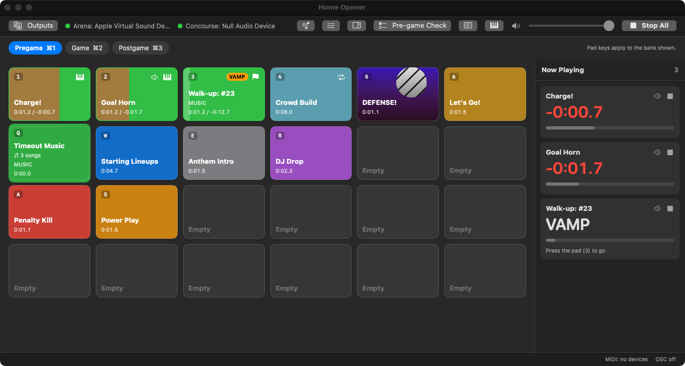
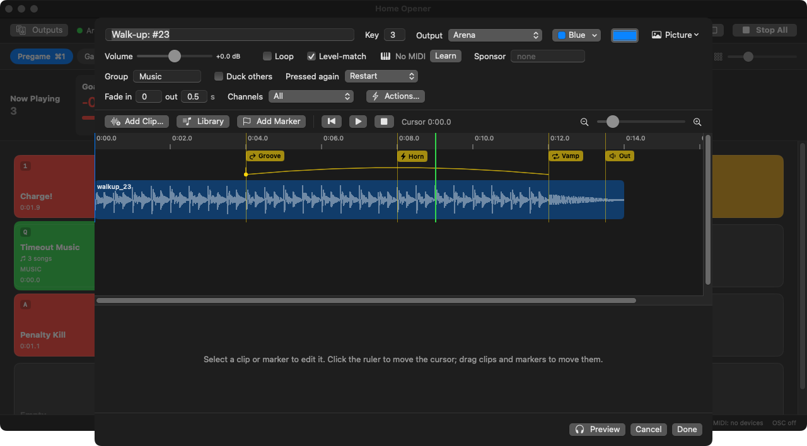
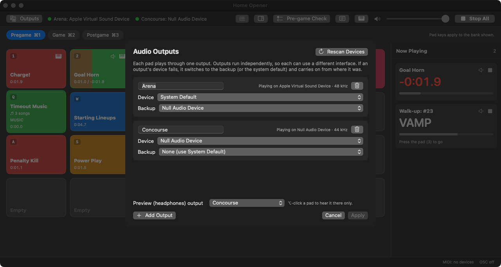
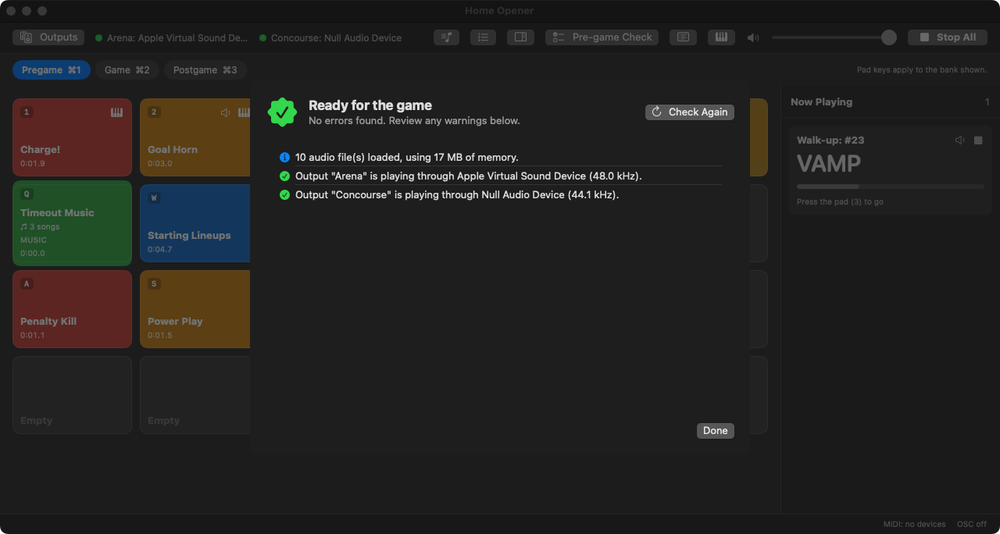
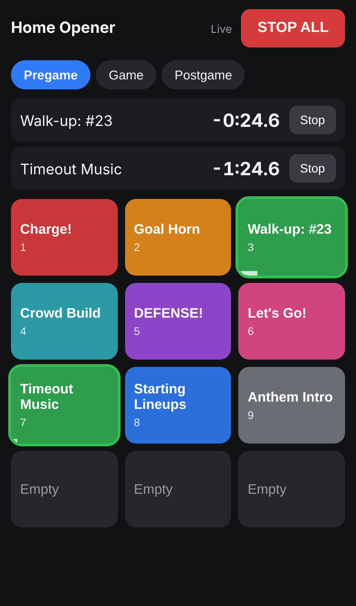
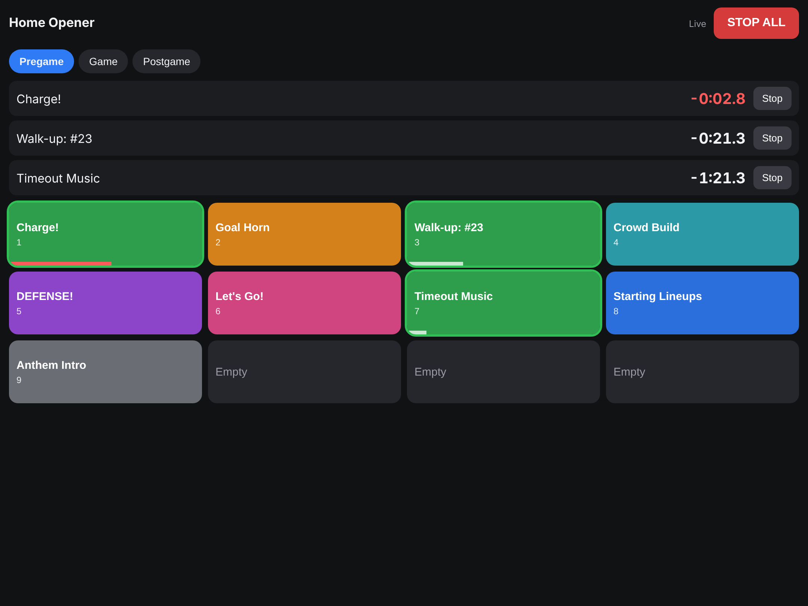

# Sportsball Jukebox

A high-performance, high-reliability sound board for live sports, built
as a native macOS app. Inspired by Sports Sounds Pro, it adds
sample-accurate timeline markers with actions (loop, jump, pause, fade) and
support for several audio interfaces at once.

**Status:** Phase 11, awaiting testing on a Mac. A Mac app with:
- a configurable pad grid with hotkeys and colours;
- show files that autosave;
- several audio interfaces at once, with automatic failover to a backup;
- a pad editor with a waveform timeline and markers that jump, loop,
  pause, stop, fade, change the volume, or fire and stop other pads at the
  exact sample, with click-free crossfades at every jump;
- banks of pads, MIDI triggers with learn, OSC network control (and so
  Stream Deck), and a pre-game check;
- vamps, exclusive groups, ducking, playlists with crossfades, and
  per-pad fades;
- a Now Playing panel and headphone preview;
- a game log with song and sponsor totals;
- a phone/tablet remote served by the app over the local network;
- level matching (EBU R128) so every pad plays at the same loudness, and
  automatic trimming of silence at the start of dropped files;
- a game rundown fired step by step with GO (Space, MIDI, OSC or the
  phone remote).

Requires macOS 14.2+. To install, see [docs/install.md](docs/install.md);
to try everything, [docs/testing-on-mac.md](docs/testing-on-mac.md). The
design is in [docs/architecture.md](docs/architecture.md).

## Screenshots

Captured automatically by CI from a generated demo show
(`scripts/make-screenshots.sh`).

| | |
|---|---|
|  |  |
| Pads, banks and live playback | Pad editor: waveform timeline and markers |
|  |  |
| Outputs with backup devices | Pre-game check |
|  |  |
| Phone remote (web page served by the app) | Tablet remote |

## Layout

```
apple/           macOS app (SwiftUI); Xcode project generated from project.yml
crates/
  sbj-engine/    real-time engine: timeline, markers, players, mixing
  sbj-backend/   audio devices: Core Audio (via cpal) + offline backend for tests
  sbj-media/     file decoding and sample-rate conversion
  sbj-session/   app model: shows, outputs, cues, banks, MIDI/OSC mapping, pre-game check
  sbj-control/   MIDI (CoreMIDI) and OSC (UDP) listeners, phone/tablet remote (HTTP)
  sbj-ffi/       C ABI for the Swift app (header in include/)
scripts/         build helpers (Rust engine → universal static library)
docs/            architecture, Mac testing guide, MIDI/OSC/Stream Deck, releasing
```

## Development

Requires only Rust (version pinned in `rust-toolchain.toml`; `rustup`
installs it automatically).

```sh
cargo test --workspace                                # all tests
cargo clippy --workspace --all-targets -- -D warnings # lint
cargo fmt --all                                       # format
cargo build --release -p sbj-ffi --target aarch64-apple-darwin  # Mac static lib
```

All Rust crates build and test on Linux, macOS or Windows; on Linux the
real-device backend is a stub and tests use the offline backend. The Mac
app needs a Mac to run. CI builds it on GitHub's macOS runners, and
[docs/testing-on-mac.md](docs/testing-on-mac.md) covers building it
locally.

## CI

- **Linux:** fmt, clippy, tests and the C API smoke test on every push.
- **macOS:** tests, then builds `Sportsball Jukebox.app` (universal,
  ad-hoc signed) as a downloadable artifact. Runs on pull requests, pushes
  to `main`, and manual runs (Actions → CI → Run workflow), to save macOS
  minutes.
